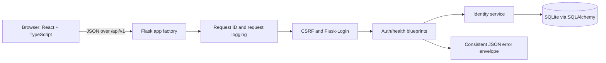
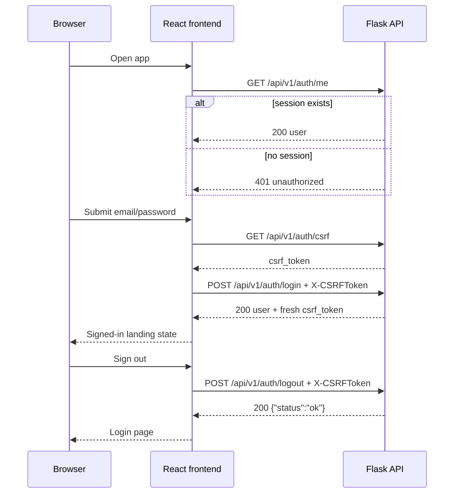
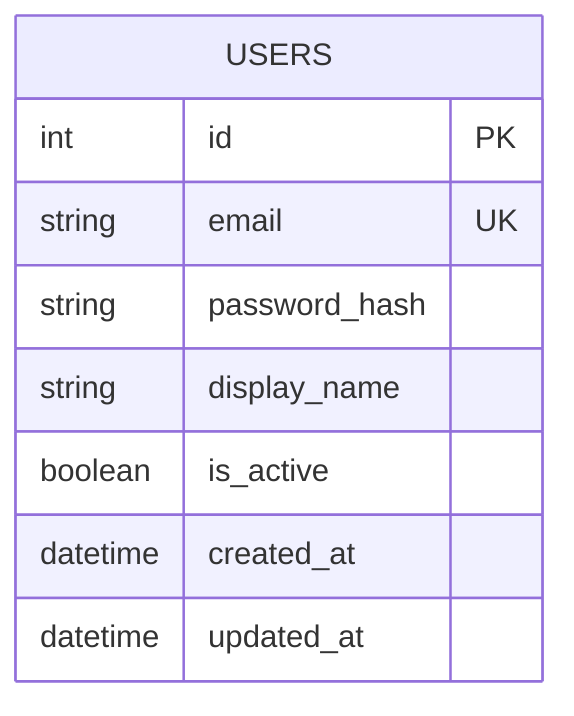

# ProjectPulse Report Brief

This document is a source pack for writing a detailed academic report about ProjectPulse. It separates what is actually implemented from what is planned, and it deliberately includes the modules that are **not** implemented so the report does not overstate the project.

- Repository: <https://github.com/MorphIsDed/Project-Pulse>
- Branch: `main`
- Snapshot commit: `871f918` (`Merge branch 'feat/m1-identity' into main`)
- Snapshot date: 2026-10-26
- Purpose: implementation evidence, architecture notes, test evidence, limitations, and a suggested report structure.

> **Most important caution:** the repository contains files for organizations, workspaces, projects, tasks, and analytics, but those files are **not wired into the running application** and are not backed by current models, migrations, or tests. They must be described as dormant/unintegrated code, not as implemented features. See [Dormant and unintegrated code](#10-dormant-and-unintegrated-code).

> **Historical snapshot notice:** this brief describes commit `871f918` from October 26, 2026. It predates the subsequent P0–P4 implementation and is not an accurate status report for the current `main` branch. Use [README.md](../README.md), [deployment guidance](deployment.md), [architecture](architecture.md), and the live source/tests for current behavior. The snapshot details below are retained only as history for the academic report.

---

## 1. How to use this brief

Use this document in three ways:

1. Copy verified facts and file references into the report.
2. Use the module status tables to separate completed work from future work.
3. Use the suggested report outline in [Section 14](#14-suggested-report-outline) to structure the final document.

The brief is intentionally explicit about evidence. A feature is counted as implemented only when it is wired into the active Flask app, has a current data model/migration where needed, and has tests or a documented manual verification path.

Status labels used in this document:

| Label | Meaning |
| --- | --- |
| Implemented | Active in the running application and supported by tests or documented verification. |
| Dormant | Code exists in the repository but is not imported, registered, migrated, or tested. Do not claim it as working. |
| Not implemented | No active implementation exists yet; only the target design is documented. |

---

## 2. Executive summary

ProjectPulse is an academic, locally deployed project planning and analytics application. The intended product combines a React + TypeScript frontend, a Flask JSON API, and a SQLite database in a modular monolith. The long-term goal is to support organizations, workspaces, projects, tasks, dependencies, calendars, resource analysis, schedule calculation, risk simulation, and calendar export.

At the snapshot commit, the project has completed:

- **M0 — Platform foundation:** application factory, configuration, database and migration setup, error envelope, request IDs, health endpoint, CLI, test fixtures, and CI.
- **M1 — Identity:** user model and migration, password hashing, email normalization, registration policy, login/logout/current-user endpoints, CSRF protection, remember-me, demo-account seeding, and a React sign-in experience with session restore.

The project has **not** completed organization/workspace tenancy, project/task planning, Gantt scheduling, resource analytics, risk simulation, ICS export, or the final evaluation.

The repository also contains an older, parallel implementation of organization/workspace/project/task/analytics routes from earlier commits. Those routes are not part of the current app factory and cannot run against the current database layer. They are historical artifacts, not completed modules.

---

## 3. Repository snapshot and technology stack

| Area | Technology |
| --- | --- |
| Backend | Python 3.11+, Flask 3.1, Flask-SQLAlchemy, Flask-Migrate/Alembic, Flask-WTF/CSRF, Flask-Login |
| Database | SQLite |
| Frontend | React, TypeScript, Vite |
| Frontend tests | Vitest, jsdom, React Testing Library |
| Backend tests | pytest, pytest-flask |
| CI | GitHub Actions (`.github/workflows/ci.yml`) |
| Authentication | Same-origin cookie sessions with Flask-Login and CSRF tokens |

### Repository map

| Path | Purpose |
| --- | --- |
| `backend/app/__init__.py` | Flask app factory and extension/blueprint registration. |
| `backend/app/config.py` | Environment loading and development/testing/production configuration. |
| `backend/app/extensions.py` | SQLAlchemy, Migrate, LoginManager, CSRF, and SQLite pragmas. |
| `backend/app/errors.py` | Consistent JSON error envelope and exception handlers. |
| `backend/app/request_context.py` | Request IDs, timing, and access logging. |
| `backend/app/api/` | Active auth/health blueprints plus dormant prototype route files. |
| `backend/app/models/` | SQLAlchemy models; currently only `User`. |
| `backend/app/services/identity.py` | User validation, password handling, authentication, and demo seeding. |
| `backend/migrations/` | Alembic configuration and two revisions. |
| `backend/tests/` | Backend test suite and fixtures. |
| `frontend/src/` | React app, auth context, API client, login page, and tests. |
| `docs/` | Architecture, API conventions, scheduling assumptions, deployment notes, and this brief. |
| `.github/workflows/ci.yml` | Backend and frontend CI jobs. |

> `backend/Dockerfile` and `docs/deployment.md` are present but describe the older raw-SQLite prototype. They are not consistent with the current M1 architecture. See [Known limitations and inconsistencies](#13-known-limitations-and-inconsistencies).

---

## 4. Product context, goals, and non-goals

### 4.1 Problem and target user

The project targets a small organization or project team that needs to plan work locally. The planned application helps users:

- organize work into organizations, workspaces, and projects;
- create tasks and dependencies;
- calculate a schedule from working calendars;
- identify critical work and float;
- detect resource overload;
- estimate deadline confidence;
- export project dates to a calendar.

The initial performance target is approximately **1,000 tasks in one project**. Live multi-user co-editing is outside the first release.

### 4.2 Goals

- Provide a working local planning and analysis application.
- Show task timing, dependency effects, critical work, resource overload, and deadline uncertainty.
- Keep scheduling and analytics logic independent of Flask request state.
- Use consistent, testable API and database conventions.
- Evaluate the application with documented scenarios and measured performance.

### 4.3 Non-goals for the initial release

- Live multi-user editing or real-time presence.
- Enterprise single sign-on.
- Portfolio-level optimization or cross-project resource pooling.
- Two-way calendar synchronization or OAuth calendar integrations.
- Globally optimal resource-constrained scheduling.
- Email notifications unless the core application is complete and time remains.

The full product plan is in [plan.md](../plan.md).

---

## 5. Implementation status at a glance

| Module | Status | Summary |
| --- | --- | --- |
| M0 — Platform foundation | Implemented | App factory, config, SQLAlchemy, Alembic, CSRF/login scaffolding, error envelope, request IDs, health, CLI, tests, CI. |
| M1 — Identity | Implemented | User model and migration, password hashing, login/logout/me, CSRF, remember-me, demo users, React auth flow. |
| M2 — Organization/workspace access control | Not implemented | No active organization, membership, workspace, or role models or routes. Dormant prototype files exist. |
| M3 — Project/task planning | Not implemented | No active project, task, dependency, calendar, resource, or assignment models or routes. Dormant prototype files exist. |
| M4–M5 — Scheduling and Gantt | Not implemented | No active calendar arithmetic, dependency propagation, CPM, float, or Gantt UI. Dormant analytics prototype exists. |
| M6 — Resource analytics | Not implemented | No active load profiles, overload detection, or leveling preview. Dormant prototype routes exist. |
| M7 — Risk simulation | Not implemented | No PERT inputs, Monte Carlo simulation, saved runs, or confidence results. |
| M8 — ICS export | Not implemented | No calendar export endpoint or UI. |
| Phase 8 — Evaluation and final report | Not started/ongoing | No benchmark dataset, performance results, or user-evaluation record in the repository. |


---

## 6. Architecture as implemented

### 6.1 Request lifecycle



The active backend is a Flask application factory. `create_app()` in `backend/app/__init__.py` loads configuration, validates it, initializes extensions, registers blueprints and CLI commands, registers error handlers, and registers request-context hooks.

### 6.2 Backend components

- **App factory:** `create_app(config_name=None, overrides=None)` in `backend/app/__init__.py`.
- **Configuration:** `backend/app/config.py` loads root `.env` and `backend/.env`, selects development/testing/production configuration, and provides an environment-variable boolean helper.
- **Extensions:** `backend/app/extensions.py` initializes SQLAlchemy with a naming convention, Flask-Migrate with batch mode, Flask-Login, and Flask-WTF CSRF. SQLite foreign keys and a busy timeout are enabled per connection.
- **Blueprints:** `backend/app/api/__init__.py` registers only `auth_api` and `health_api`.
- **Error handling:** `backend/app/errors.py` converts API errors, CSRF errors, HTTP errors, and unexpected exceptions into one JSON envelope.
- **Request correlation:** `backend/app/request_context.py` assigns or echoes `X-Request-ID`, measures duration, and logs method/path/status/duration/request ID.
- **Health check:** `backend/app/api/health.py` executes `SELECT 1` and returns 200 or 503.
- **CLI:** `backend/app/cli.py` registers `flask seed-demo`.
- **Database:** `backend/app/models/user.py` is the only active model; `backend/migrations/versions/` contains the baseline and the users migration.
- **Frontend:** `frontend/src/App.tsx` controls session restore, health display, login, signed-in landing state, and sign-out. `frontend/src/auth/AuthContext.tsx` owns user/session state. `frontend/src/lib/api.ts` owns CSRF handling and API calls. `frontend/src/pages/LoginPage.tsx` renders the sign-in form.

### 6.3 Security and API conventions

- Authentication uses same-origin cookie sessions backed by Flask-Login.
- State-changing requests require an `X-CSRFToken` header. The frontend obtains a token from `GET /api/v1/auth/csrf`, retries once on `csrf_error`, and refreshes the token after login/registration.
- Error responses use one envelope:
  ```json
  {
    "error": {
      "code": "validation_error",
      "message": "Required fields are missing.",
      "details": { "fields": ["email"] },
      "request_id": "4f4c12f0a7e14f0f9f5b0d4f3f7d2a1c"
    }
  }
  ```
- `code` is stable and machine-readable; `message` is safe to display; `details` is optional; `request_id` matches the `X-Request-ID` response header and log entry.
- Unhandled exceptions return a generic `internal_error`; stack traces stay in server logs.
- API calendar dates use `YYYY-MM-DD`; audit timestamps use UTC ISO 8601; durations and lags use integer working minutes.
- See [docs/api-conventions.md](api-conventions.md) for the full convention.

---

## 7. Implemented module M0 — Platform foundation

### 7.1 What exists

| Capability | Evidence | Notes |
| --- | --- | --- |
| Flask app factory | `backend/app/__init__.py` | Loads config, initializes extensions, registers blueprints/CLI/errors/request context. |
| Environment configuration | `backend/app/config.py`, `.env.example`, `backend/.flaskenv` | Development, testing, and production classes. Production requires `SECRET_KEY`. |
| SQLAlchemy and Alembic | `backend/app/extensions.py`, `backend/migrations/` | Baseline revision and `add users` revision. Batch mode for SQLite. |
| Session/auth scaffolding | `backend/app/__init__.py`, `backend/app/extensions.py` | Flask-Login user loader and unauthorized handler; Flask-WTF CSRF. |
| Error envelope | `backend/app/errors.py`, `docs/api-conventions.md` | API/CSRF/HTTP/unexpected exception handlers. |
| Request IDs and logging | `backend/app/request_context.py` | Generates/echoes `X-Request-ID`; logs method, path, status, duration, request ID. |
| Health endpoint | `backend/app/api/health.py` | Database-aware 200/503 response. |
| Demo seeding CLI | `backend/app/cli.py`, `backend/app/services/identity.py` | Idempotent `seed-demo`; refuses production unless `--force`. |
| Test fixtures | `backend/tests/conftest.py` | Isolated temporary SQLite database per app; no production/instance database. |
| CI | `.github/workflows/ci.yml` | Backend migrations up/down/up, seed-demo, pytest; frontend npm ci, tests, build. |

### 7.2 Configuration defaults

| Variable | Purpose | Default |
| --- | --- | --- |
| `SECRET_KEY` | Flask session signing key | Development fallback (`development-only-change-me`). |
| `DATABASE_URL` | SQLAlchemy database URI | `sqlite:///projectpulse.sqlite3` (resolves under `backend/instance/`). |
| `APP_ENV` | `development`, `testing`, or `production` | `development`. |
| `ALLOW_PUBLIC_SIGNUP` | Enables public registration | `false`. |
| `DEMO_PASSWORD` | Password assigned by `seed-demo` | `DemoPulse123!`. |
| `LOG_LEVEL` | `DEBUG`, `INFO`, `WARNING`, or `ERROR` | `INFO`. |

Production enables secure session and remember cookies and requires a real `SECRET_KEY`.

### 7.3 CI pipeline

The GitHub Actions workflow runs on pushes and pull requests targeting `main`:

**Backend job**
1. Check out the repository and install Python 3.11.
2. Install `requirements.txt`.
3. Run `flask --app wsgi db upgrade`.
4. Run `flask --app wsgi db downgrade base`.
5. Run `flask --app wsgi db upgrade`.
6. Run `flask --app wsgi seed-demo`.
7. Run `python -m pytest -q`.

**Frontend job**
1. Check out the repository and install Node LTS.
2. Run `npm ci`.
3. Run `npm test`.
4. Run `npm run build`.

The migration cycle is important evidence: it checks that the schema can be created, removed, and recreated from Alembic alone.

---

## 8. Implemented module M1 — Identity

### 8.1 Data model

The active data model contains one table, `users`, created by migration `bef85313fea6`.

| Column | Type/constraint | Purpose |
| --- | --- | --- |
| `id` | Integer primary key | Internal user identifier. |
| `email` | String(320), unique, indexed, not null | Normalized login identity. |
| `password_hash` | String(255), not null | Werkzeug password hash; never returned by the API. |
| `display_name` | String(80), not null | Human-readable name. |
| `is_active` | Boolean, not null, default true | Allows accounts to be disabled. |
| `created_at` | Timezone-aware datetime, not null | UTC audit timestamp. |
| `updated_at` | Timezone-aware datetime, not null | UTC audit timestamp. |

The model is in `backend/app/models/user.py`. The migration is in `backend/migrations/versions/bef85313fea6_add_users.py`. `backend/app/models/__init__.py` imports only `User`, so Alembic autogenerate currently discovers only that table.

### 8.2 Identity rules

- Email is stripped and lowercased before validation and storage.
- Email must match a simple address pattern and be at most 320 characters.
- Password must be 8–128 characters.
- Display name must be non-empty and at most 80 characters.
- Passwords are hashed with Werkzeug's `generate_password_hash`; login uses `check_password_hash`.
- Unknown email and wrong password both return the same `401 invalid_credentials` message.
- Inactive users cannot log in.
- Duplicate registration returns `409 email_taken`.
- Public registration is disabled by default and returns `403 registration_disabled` unless `ALLOW_PUBLIC_SIGNUP=true`.
- User responses contain `id`, `email`, and `display_name` only; password hashes are never returned.

### 8.3 Authentication endpoints

| Method | Path | Auth | CSRF | Purpose |
| --- | --- | --- | --- | --- |
| `GET` | `/api/v1/auth/csrf` | No | No | Issue a CSRF token. |
| `POST` | `/api/v1/auth/register` | No | Yes | Create an account when public signup is enabled. |
| `POST` | `/api/v1/auth/login` | No | Yes | Start a cookie session. |
| `POST` | `/api/v1/auth/logout` | No (idempotent) | Yes | End the session; idempotent. |
| `GET` | `/api/v1/auth/me` | Session | No | Return the current user. |
| `GET` | `/api/v1/health` | No | No | Check API and database health. |

Login and registration accept JSON with `email` and `password`; registration also needs `display_name`; login optionally accepts `remember`. Successful login/registration return:

```json
{
  "user": { "id": 1, "email": "owner@demo.local", "display_name": "Demo Owner" },
  "csrf_token": "..."
}
```

`remember=true` sets Flask-Login's remember cookie, configured for 14 days. Logout clears the session and returns `{"status": "ok"}`.

### 8.4 Login and CSRF sequence



### 8.5 Demo accounts and seeding

`flask seed-demo` creates three accounts idempotently:

| Email | Display name | Future role label |
| --- | --- | --- |
| `owner@demo.local` | Demo Owner | organization owner |
| `editor@demo.local` | Demo Editor | editor |
| `viewer@demo.local` | Demo Viewer | viewer |

The default password is `DemoPulse123!` unless `DEMO_PASSWORD` is set. The role labels are **not enforced yet** because organization memberships and roles are part of M2. The command skips existing accounts and refuses to run in production unless `--force` is passed.

### 8.6 Frontend auth experience

- `AuthProvider` restores the session on mount by calling `/auth/me`; a 401 quietly clears the user.
- `LoginPage` pre-fills `owner@demo.local`, accepts an optional "keep me signed in" checkbox, disables submit while pending, and shows API error messages.
- The signed-in view shows the display name, email, health status, and a sign-out action.
- The API client fetches a CSRF token before unsafe methods, retries once on `csrf_error`, and refreshes the token after login/registration.
- The app shows the API health state and the seeded demo credentials on the login screen.

### 8.7 Identity test coverage

Backend tests cover registration policy, registration success and validation, duplicate email handling, password hashing/non-exposure, login success/failure, inactive users, remember cookies, logout idempotence, session requirements, CSRF enforcement, demo seeding, configuration validation, error envelopes, request IDs, health behavior, and database isolation.

Frontend tests cover session restore, unauthorized sessions, login success/failure, logout success/failure, health online/offline states, form defaults and accessibility, remember-me, pending/disabled state, API error display, and auth context guards.

---

## 9. Actual API and data model

### 9.1 Actual API surface

Only these routes are active at snapshot `871f918`:

- `GET /api/v1/health`
- `GET /api/v1/auth/csrf`
- `POST /api/v1/auth/register`
- `POST /api/v1/auth/login`
- `POST /api/v1/auth/logout`
- `GET /api/v1/auth/me`

### 9.2 Actual entity-relationship model



No active relationships exist yet. The target model is much larger and is described in [Section 11](#11-target-data-model).

---

## 10. Dormant and unintegrated code

This section is essential for an accurate report.

The repository contains route files for organizations, workspaces, projects, tasks, and analytics. They came from an earlier parallel implementation and were carried into `main` by the merge history. Merge commit `871f918` resolved the integration in favor of the M1 architecture, so the older route files remain as inactive artifacts. They are **not part of the current application**:

- `backend/app/api/__init__.py` registers only `auth_api` and `health_api`.
- The dormant modules import `from app import get_db`, but the current M1 app factory does not define `get_db`.
- The current SQLAlchemy models contain only `User`; there are no organization, membership, workspace, project, task, dependency, calendar, resource, assignment, or analysis-run models.
- The current Alembic migrations create only the `users` table.
- There are no tests for the dormant modules.
- The old raw-SQLite schema that these modules expect is not created by the current migrations.

### 10.1 Dormant files and routes

| File | Routes it would expose | Why it is not active |
| --- | --- | --- |
| `backend/app/api/organizations.py` | `GET/POST /api/v1/organizations` | Imports missing `app.get_db`; not registered; no models/migrations/tests. |
| `backend/app/api/workspaces.py` | `GET/POST /api/v1/organizations/<id>/workspaces` | Same. |
| `backend/app/api/projects.py` | `GET/POST /api/v1/workspaces/<id>/projects`; `PATCH /api/v1/projects/<id>` | Same. |
| `backend/app/api/tasks.py` | `GET/POST /api/v1/projects/<id>/tasks`; `PATCH /api/v1/projects/<id>/tasks/<task_id>` | Same. |
| `backend/app/api/analytics.py` | Schedule, insights, resources, dependencies, workload, and assignment routes | Same; assumes earlier SQLite schema and a weekday/8-hour calendar model. |

### 10.2 What the report should say

Use language such as:

> An earlier prototype contains route handlers for tenancy, planning, and analytics, but these are not integrated into the current application factory and are not supported by the current SQLAlchemy models, migrations, or tests. They are therefore treated as historical, dormant code rather than implemented features.

Do **not** claim:

- that organizations, workspaces, projects, tasks, or analytics are working;
- that the dormant routes are part of the API;
- that the database supports tenancy or scheduling;
- that the frontend can create projects or tasks.

### 10.3 Deployment artifacts are also stale

`backend/Dockerfile` and `docs/deployment.md` now describe the SQLite production stack using the `PROJECTPULSE_*` configuration, Caddy HTTPS edge, scheduled backups, Flask-Migrate revisions, and the first-owner bootstrap command. The application uses SQLite for domain tables and Flask-SQLAlchemy for the user model; the core migration preserves the existing SQLite-specific triggers and schema behavior.

---

## 11. Target data model

The target model from [plan.md](../plan.md) is broader than the current implementation. The table below is useful for the report's "future work" and "system design" sections.

| Entity | Purpose | Status |
| --- | --- | --- |
| `users` | Global identity and password hash. | Implemented. |
| `organizations` | Top-level tenant. | Not implemented. |
| `organization_memberships` | User role within an organization. | Not implemented. |
| `workspaces` | Organization-owned grouping of projects. | Not implemented. |
| `workspace_memberships` | Optional finer-grained access. | Not implemented; open policy decision. |
| `projects` | Workspace-owned plan with status, calendar, version, dates, and creator. | Not implemented. |
| `tasks` | Project work item with hierarchy, status, duration, progress, priority, constraints, and PERT estimates. | Not implemented. |
| `dependencies` | Directed task link with FS/SS/FF/SF type and lag. | Not implemented. |
| `calendars` | Working intervals, timezone, holidays, and exceptions. | Not implemented. |
| `resources` | Project-scoped capacity. | Not implemented. |
| `assignments` | Resource allocation to tasks. | Not implemented. |
| `analysis_runs` | Reproducible record of analytics/simulation inputs and results. | Not implemented. |
| `audit_events` | Lightweight record of important changes. | Not implemented. |

Target conventions:

- Integer primary keys and foreign keys.
- Unique membership pairs.
- ISO 8601 dates/timestamps; UTC audit timestamps.
- Foreign-key enforcement on every SQLite connection.
- Project version checks for stale edits.
- Schedule inputs stored separately from derived dates and analysis results.

---

## 12. Unimplemented modules in detail

The project plan uses implementation milestones. The sections below describe what each remaining module must deliver, what evidence is missing, and what the report can say about it.

### 12.1 M2 — Organization/workspace access control

**Goal:** establish tenant boundaries and authorization.

**Required work**
- Models and migrations for organizations, organization memberships, workspaces, and optional workspace memberships.
- Role definitions and permissions (for example owner, admin, editor, and viewer; the exact role set is an open decision).
- Organization and workspace CRUD/list endpoints with pagination.
- Membership management and role enforcement.
- Access checks that trace project access through workspace and organization membership.
- Frontend organization/workspace switcher and settings/members screens.

**Planned API outline**
- `GET/POST /api/v1/organizations`
- `GET/POST /api/v1/organizations/<id>/workspaces`
- Membership/role endpoints under organizations/workspaces.

**Acceptance criteria**
- A user cannot read or mutate another organization's data.
- Unauthorized users receive the documented 401/403/404 behavior.
- Membership and role changes take effect on subsequent requests.

**Current state:** not implemented. Dormant route files exist, but they are not wired and have no models/migrations/tests. The three demo accounts have role labels only; no membership records exist.

**Report note:** this is the first missing module and a prerequisite for every project/task feature.

### 12.2 M3 — Project and task planning

**Goal:** let authorized users create projects and plan work items.

**Required work**
- Models and migrations for projects, tasks, dependencies, calendars, resources, and assignments.
- Project CRUD with status, dates, version, and calendar.
- Task CRUD with hierarchy, descriptions, duration, progress, priority, constraints, and PERT estimates.
- Dependency CRUD with FS/SS/FF/SF types and lag.
- Validation for self-links, duplicate edges, cross-project links, and cycles.
- Pagination and consistent errors.
- Frontend project/task forms, lists, hierarchy, and editing.

**Planned API outline**
- `GET/POST /api/v1/workspaces/<id>/projects`
- `PATCH/DELETE /api/v1/projects/<id>`
- `GET/POST /api/v1/projects/<id>/tasks`
- `PATCH/DELETE /api/v1/projects/<id>/tasks/<task_id>`
- Dependency/resource/assignment routes.

**Acceptance criteria**
- Create/edit/delete flows work.
- Invalid and cross-project links are rejected.
- Authorization is checked on every project read and mutation.
- Project versions detect stale edits.

**Current state:** not implemented. The dormant `projects.py` and `tasks.py` files show an earlier route shape only; they have no active models, migrations, tests, or UI.

### 12.3 M4–M5 — Scheduling and Gantt

**Goal:** calculate and display a dependency-aware schedule.

**Required work**
- Calendar arithmetic for working minutes, nonworking intervals, holidays, and exceptions.
- Four dependency types with lag: FS, SS, FF, SF.
- Cycle detection and readable validation errors for infeasible constraints.
- Forward/backward passes, earliest/latest dates, project finish, total float, free float, critical path.
- Project versioning for schedule snapshots.
- Interactive Gantt UI and schedule recalculation endpoint.
- Hand-calculated test cases for calendars, lags, milestones, and dependency types.

**Acceptance criteria**
- Hand-calculated scenarios produce expected dates, critical path, and float.
- Cycles and cross-project links are rejected.
- Finish-event semantics and exclusive boundaries are applied consistently.
- A project with no imposed deadline uses the latest task finish; a target finish/deadline is visible when used.

**Current state:** not implemented. The dormant `analytics.py` contains a weekday/8-hour scheduling prototype, but it is not registered, not migrated, not tested, and not connected to the frontend.

### 12.4 M6 — Resource analytics and leveling preview

**Goal:** identify resource overload and propose explainable leveling adjustments.

**Required work**
- Resource and assignment models/migrations.
- Working-interval or daily load profiles per resource.
- Overload results with resource, interval, assigned load, capacity, and contributing tasks.
- Leveling preview that preserves dependencies and fixed dates, prioritizes lower-priority tasks, then tasks with more float, then stable task ID.
- User-facing acceptance/rejection of proposals.
- Tests for aggregation and preview behavior.

**Acceptance criteria**
- Overload results identify contributing tasks.
- Proposals respect dependencies when feasible.
- The preview is presented as a heuristic, not an optimal solver.

**Current state:** not implemented. Dormant analytics routes exist for resources/workload/assignments; they are not active.

### 12.5 M7 — Risk simulation

**Goal:** estimate deadline confidence with explicit uncertainty.

**Required work**
- PERT inputs: optimistic (`a`), most-likely (`m`), pessimistic (`b`).
- Beta-PERT sampling; deterministic tasks remain fixed.
- Seeded Monte Carlo runs with configurable iterations and target deadline.
- Saved analysis runs keyed to project version and parameters.
- Median/percentile finish dates and deadline-hit probability.
- Reproducibility tests for fixed seeds.

**Acceptance criteria**
- Fixed-seed runs are reproducible.
- Deterministic tasks produce deterministic dates.
- Results expose assumptions and are labelled as planning estimates, not guarantees.

**Current state:** not implemented. No simulation code, saved-run model, or UI exists.

### 12.6 M8 — ICS export

**Goal:** export selected project events to a calendar application.

**Required work**
- ICS generation for selected project dates/events.
- Download endpoint and frontend action.
- Timezone/date-boundary handling consistent with scheduling conventions.
- Verification by importing the generated file into a calendar application.

**Acceptance criteria**
- Exported ICS imports successfully.
- Dates and event boundaries match the displayed schedule.
- Access control is enforced on export.

**Current state:** not implemented. `icalendar` is listed in `requirements.txt`, but no active export code exists.

### 12.7 Phase 8 — Evaluation and final report

**Goal:** produce measured evidence and an academic evaluation.

**Required work**
- Demo data and scenario definitions (parallel paths, shared resources, holidays, milestones, imposed deadline).
- Performance measurements near 1,000 tasks, including hardware, input shape, and run count.
- Unit/API/frontend checks for scheduling, validation, permissions, recalculation, and reproducibility.
- Small user evaluation of creating a plan, adding dependencies, finding critical work, resolving overload, and interpreting deadline confidence.
- Documented limitations, assumptions, and measured results.

**Current state:** not started in the repository. The existing tests cover only M0/M1.

---

## 13. Known limitations and inconsistencies

### 13.1 Accuracy cautions for the report

- **Dormant code:** organization/workspace/project/task/analytics files exist but are not active. Do not count them as completed modules.
- **No tenant isolation yet:** there are no organization or workspace tables, so cross-organization access cannot be tested or enforced.
- **No project UI:** the frontend only supports sign-in, session restore, health display, and sign-out.
- **Role labels are aspirational:** `owner@demo.local`, `editor@demo.local`, and `viewer@demo.local` are display identities only; no role/membership enforcement exists.
- **SQLite only:** no PostgreSQL or other database support is implemented.
- **Deployment docs are stale:** `docs/deployment.md` and `backend/Dockerfile` describe the earlier raw-SQLite prototype and its environment variables, not the current M1 configuration.
- **Coverage is limited to M0/M1:** no tests exist for tenancy, planning, scheduling, analytics, risk, or export.
- **No benchmark results:** the 1,000-task performance target has not been measured in the repository.

### 13.2 Technical debt and risks

- The merge history contains two different architectural approaches; future work should either delete or fully port the dormant files to avoid confusion.
- If the dormant route files are imported by future code, they will fail on the missing `app.get_db` symbol and missing tables.
- M2 must be completed before M3 and later modules because project access depends on tenancy.
- Scheduling and analytics should remain independent of Flask request state, as required by the design.
- The current CI verifies M0/M1 only; later modules must add their own tests and migration checks.

### 13.3 Open decisions

The following decisions are undecided and should be discussed in the report's future-work section:

- Is organization membership sufficient for access, or is workspace membership mandatory?
- Which roles exist, and which actions may each role perform?
- Which task constraints are hard versus advisory?
- Can each project choose its timezone and working hours, or is a fixed weekday calendar used first?
- Which Gantt interactions/library best fit the academic evaluation?
- Is password login required for the demo, or are seeded local accounts sufficient?

---

## 14. Suggested report outline

The following structure maps directly to the evidence in this repository.

| Chapter | Suggested content | Primary evidence |
| --- | --- | --- |
| 1. Introduction | Background, problem statement, target users, academic objectives. | `README.md`, `plan.md` |
| 2. Requirements and scope | Functional requirements, non-goals, roles, workflows, acceptance criteria. | `plan.md`, `docs/architecture.md` |
| 3. System design | Modular monolith, architecture diagram, request lifecycle, data model, API conventions, security model. | `docs/architecture.md`, `docs/api-conventions.md`, this brief |
| 4. Implemented modules | M0 foundation and M1 identity, including screenshots or endpoint examples. | `backend/app/`, `frontend/src/`, this brief |
| 5. Testing and verification | Test strategy, 51 backend tests, 38 frontend tests, CI pipeline, migration cycle, manual test path. | `backend/tests/`, `frontend/src/**/*.test.*`, `.github/workflows/ci.yml` |
| 6. Unimplemented modules | M2–M8 and evaluation, with scope, design, acceptance criteria, dependencies, and risks. | `plan.md`, this brief, `docs/scheduling-assumptions.md` |
| 7. Limitations and risks | Dormant code, missing tenancy, stale deployment docs, SQLite-only scope, open decisions. | This brief, repository inspection |
| 8. Evaluation plan | Scenarios, performance measurement, user evaluation, reproducibility. | `plan.md`, `docs/scheduling-assumptions.md` |
| 9. Conclusion | What was achieved, what remains, lessons learned, next steps. | All of the above |
| 10. References/appendix | Repository links, file index, glossary, API examples. | This brief |

### Suggested figures and tables

- Architecture diagram (Section 6.1).
- Login/CSRF sequence diagram (Section 8.4).
- Actual ER diagram (Section 9.2).
- Target data model table (Section 11).
- Implementation status table (Section 5).
- API surface table (Section 8.3).
- Test evidence table (Section 15).
- Module gap matrix (Sections 5 and 12).

### Suggested claims and evidence

| Claim | Evidence | Caveat |
| --- | --- | --- |
| The backend uses a Flask application factory and SQLAlchemy/Alembic. | `backend/app/__init__.py`, `backend/app/extensions.py`, `backend/migrations/` | Active. |
| Authentication supports login/logout/current-user with cookie sessions and CSRF. | `backend/app/api/auth.py`, `backend/tests/test_auth.py`, `backend/tests/test_csrf_auth.py` | Active. |
| The frontend supports sign-in, session restore, health status, and sign-out. | `frontend/src/App.tsx`, `frontend/src/auth/AuthContext.tsx`, `frontend/src/pages/LoginPage.tsx`, frontend tests | Active. |
| The project has organization/workspace/project/task/analytics routes. | `backend/app/api/organizations.py`, `workspaces.py`, `projects.py`, `tasks.py`, `analytics.py` | Dormant; not registered or migrated. Do not claim as working. |
| The project supports Gantt scheduling, resource leveling, risk simulation, and ICS export. | `plan.md`, `docs/scheduling-assumptions.md` | Planned only; no active implementation. |
| CI verifies migrations, seeding, backend tests, frontend tests, and frontend build. | `.github/workflows/ci.yml` | Active for M0/M1. |

---

## 15. Test and verification evidence

### 15.1 Backend

- Command: `python -m pytest -q` from `backend/`.
- Result at the snapshot: **51 passed**.
- Test modules: `test_auth.py`, `test_config.py`, `test_csrf_auth.py`, `test_db.py`, `test_errors.py`, `test_health.py`, `test_request_context.py`, `test_seed.py`.
- Fixtures: `backend/tests/conftest.py` creates an isolated temporary SQLite database per app and drops it after the test.
- CI also runs migrations up, down to base, and up again, then runs `seed-demo`.

### 15.2 Frontend

- Command: `npm test` from `frontend/`.
- Result at the snapshot: **38 passed** across 4 test files.
- Test files: `App.test.tsx`, `auth/AuthContext.test.tsx`, `pages/LoginPage.test.tsx`, `lib/api.test.ts`.
- Build: `npm run build` runs `tsc --noEmit && vite build`.

### 15.3 Manual verification path

1. From `backend/`: `flask db upgrade`, `flask seed-demo`, `flask run --debug`.
2. From `frontend/`: `npm ci`, `npm run dev`.
3. Open the Vite URL, verify the health status, sign in with `owner@demo.local` / `DemoPulse123!`, refresh the page to confirm session restore, sign out, and try a wrong password to confirm the error message.
4. Check `http://127.0.0.1:5000/api/v1/health` returns `database: "ok"`.

---

## 16. Evidence index

| Evidence | What it demonstrates |
| --- | --- |
| [backend/app/__init__.py](../backend/app/__init__.py) | App factory, extension initialization, blueprint/CLI/error/request-context registration. |
| [backend/app/config.py](../backend/app/config.py) | Environment-based configuration and production checks. |
| [backend/app/extensions.py](../backend/app/extensions.py) | SQLAlchemy, Alembic, Flask-Login, CSRF, SQLite pragmas. |
| [backend/app/errors.py](../backend/app/errors.py) | JSON error envelope and handlers. |
| [backend/app/request_context.py](../backend/app/request_context.py) | Request IDs, timing, and access logging. |
| [backend/app/api/auth.py](../backend/app/api/auth.py) | Active authentication endpoints. |
| [backend/app/api/health.py](../backend/app/api/health.py) | Database-aware health endpoint. |
| [backend/app/api/__init__.py](../backend/app/api/__init__.py) | Proof that only auth/health blueprints are registered. |
| [backend/app/models/user.py](../backend/app/models/user.py) | Active user model. |
| [backend/app/services/identity.py](../backend/app/services/identity.py) | Password, email, authentication, and demo-seeding logic. |
| [backend/migrations/versions/](../backend/migrations/versions/) | Alembic baseline and users migration. |
| [backend/tests/](../backend/tests/) | Backend test evidence. |
| [frontend/src/App.tsx](../frontend/src/App.tsx) | Session/health/login/signed-in shell. |
| [frontend/src/auth/AuthContext.tsx](../frontend/src/auth/AuthContext.tsx) | Client session state and login/logout operations. |
| [frontend/src/lib/api.ts](../frontend/src/lib/api.ts) | CSRF-aware API client. |
| [frontend/src/pages/LoginPage.tsx](../frontend/src/pages/LoginPage.tsx) | Sign-in form and error display. |
| [frontend/src/](../frontend/src/) | Frontend tests and test setup. |
| [.github/workflows/ci.yml](../.github/workflows/ci.yml) | CI commands and quality gates. |
| [docs/api-conventions.md](api-conventions.md) | API/error/CSRF conventions. |
| [docs/architecture.md](architecture.md) | Target architecture and module boundaries. |
| [docs/scheduling-assumptions.md](scheduling-assumptions.md) | Scheduling conventions and open decisions. |
| [plan.md](../plan.md) | Full product scope, phases, and current status. |
| [README.md](../README.md) | Setup, demo accounts, tests, and current status. |

---

## 17. Glossary

| Term | Meaning |
| --- | --- |
| Alembic | Database migration tool used through Flask-Migrate. |
| CPM | Critical Path Method; computes earliest/latest dates and float. |
| CSRF | Cross-Site Request Forgery; state-changing requests require a token. |
| DAG | Directed acyclic graph; required for valid task dependencies. |
| FS/SS/FF/SF | Finish-to-start, start-to-start, finish-to-finish, start-to-finish dependency types. |
| Float | Slack time before a task affects the project finish or a successor. |
| ICS | iCalendar file format used to export events. |
| M0, M1, … | Implementation milestones used by the project plan. |
| PERT | Three-point estimate with optimistic, most-likely, and pessimistic durations. |
| SQLAlchemy | Python ORM used for the active data model. |
| Tenancy | Isolation between organizations and their data. |
| Total float | Working-time distance between earliest and latest start; zero means critical. |

---

## 18. Final checklist for the report author

- [ ] State that M0 and M1 are implemented.
- [ ] State that M2–M8 and the evaluation are not implemented.
- [ ] Explain the dormant route files and why they are not evidence of completed features.
- [ ] Include the actual API table and the target API outline separately.
- [ ] Include the actual `users` model and the target data model separately.
- [ ] Include the 51 backend / 38 frontend test results and the CI pipeline.
- [ ] Include the stale deployment-document warning.
- [ ] Include limitations, open decisions, and future work.
- [ ] Use the suggested outline and figures, adapting them to the course requirements.
- [ ] Cite the repository snapshot exactly: `main` at `871f918`.
