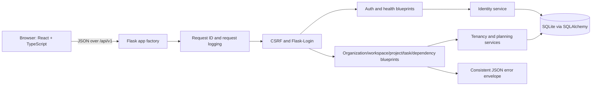
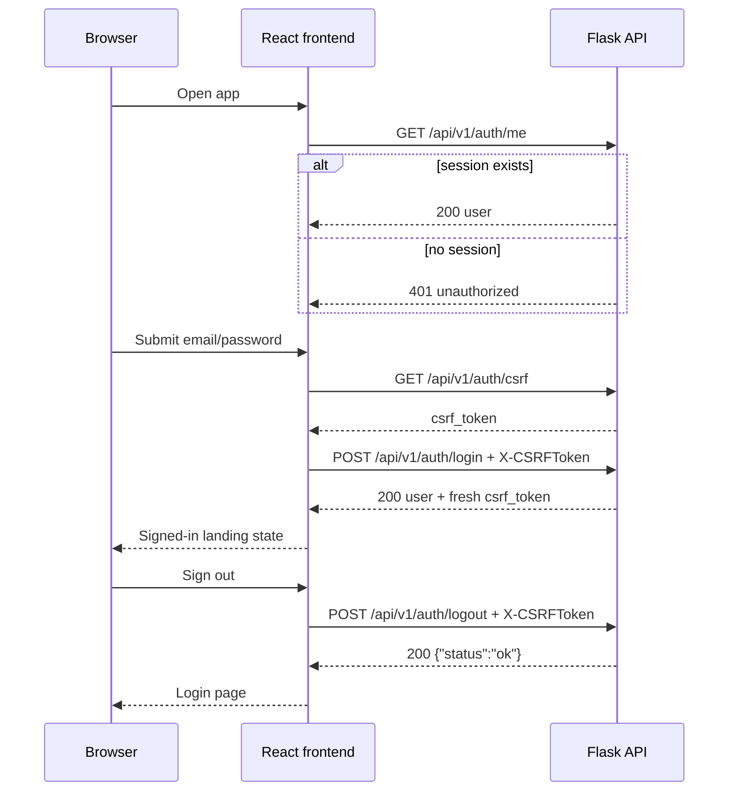
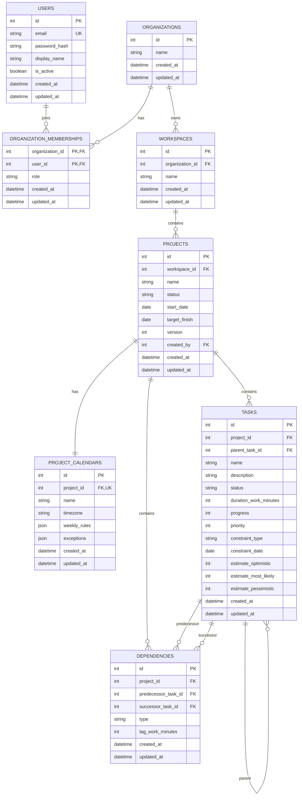

# ProjectPulse Report Brief

This document is a source pack for writing a detailed academic report about ProjectPulse. It separates what is actually implemented from what is planned, and it deliberately includes the modules that are **not** implemented so the report does not overstate the project.

- Repository: <https://github.com/MorphIsDed/Project-Pulse>
- Branch: `main`
- Last committed baseline: `c64c16f`; M2/M3/M4/M5 changes were verified in the working tree and are pending commit.
- Snapshot date: 2026-10-27
- Purpose: implementation evidence, architecture notes, test evidence, limitations, and a suggested report structure.

> **Most important caution:** M2 (tenancy/access control), M3 (core planning), M4 (calendar editing and CPM scheduling), and M5 (read-only Gantt visualization) are implemented and active. The only remaining dormant prototype is `backend/app/api/analytics.py`, which still targets the earlier raw-SQLite schema and is not registered. Do not describe resource analytics/leveling, risk simulation, or ICS export as implemented. See [Dormant and unintegrated code](#10-dormant-and-unintegrated-code).

---

## 1. How to use this brief

Use this document in three ways:

1. Copy verified facts and file references into the report.
2. Use the module status tables to separate completed work from future work.
3. Use the suggested report outline in [Section 14](#14-suggested-report-outline) to structure the final document.

The brief is intentionally explicit about evidence. A feature is counted as implemented only when it is wired into the active Flask app, has a current data model/migration where needed, and has tests or a documented manual verification path.

Status labels used in this document:

| Label | Meaning |
| --- | --- |
| Implemented | Active in the running application and supported by tests or documented verification. |
| Dormant | Code exists in the repository but is not imported, registered, migrated, or tested. Do not claim it as working. |
| Not implemented | No active implementation exists yet; only the target design is documented. |

---

## 2. Executive summary

ProjectPulse is an academic, locally deployed project planning and analytics application. The intended product combines a React + TypeScript frontend, a Flask JSON API, and a SQLite database in a modular monolith. The long-term goal is to support organizations, workspaces, projects, tasks, dependencies, calendars, resource analysis, schedule calculation, risk simulation, and calendar export.

At the snapshot date, the project has completed:

- **M0 - Platform foundation:** application factory, configuration, database and migration setup, error envelope, request IDs, health endpoint, CLI, test fixtures, and CI.
- **M1 - Identity:** user model and migration, password hashing, email normalization, registration policy, login/logout/current-user endpoints, CSRF protection, remember-me, demo-account seeding, and a React sign-in experience with session restore.
- **M2 - Organization/workspace access control:** organization membership and role models, workspaces, owner/admin/editor/viewer permissions, member management with a last-owner guard, organization/workspace/member APIs, and seeded demo tenancy.
- **M3 - Core planning:** projects, default project calendars, task hierarchy, task constraints/PERT inputs, dependencies, CRUD APIs, optimistic project versioning, graph validation, and a state-based React planning workspace.
- **M4 - Calendar editing and CPM scheduling:** timezone-aware working calendars, weekly rules and exception validation, calendar PATCH, on-demand FS/SS/FF/SF scheduling with lag, all seven constraints, target-finish warnings, earliest/latest dates, total/free float, critical path, schedule API, basic calendar editor, and schedule summary.
- **M5 - Gantt visualization:** custom read-only SVG timeline with task bars, dependency links, milestones, critical-path emphasis, float bars, weekend shading, and a schedule legend.

The project has **not** completed resource analytics/leveling, risk simulation, ICS export, or the final evaluation.

Only `backend/app/api/analytics.py` remains a dormant artifact from the earlier prototype. The old organization/workspace/project/task route files were replaced by active M2/M3 implementations, and the active scheduling package is separate from that dormant route file.

---

## 3. Repository snapshot and technology stack

| Area | Technology |
| --- | --- |
| Backend | Python 3.11+, Flask 3.1, Flask-SQLAlchemy, Flask-Migrate/Alembic, Flask-WTF/CSRF, Flask-Login |
| Database | SQLite |
| Frontend | React, TypeScript, Vite |
| Frontend tests | Vitest, jsdom, React Testing Library |
| Backend tests | pytest, pytest-flask |
| CI | GitHub Actions (`.github/workflows/ci.yml`) |
| Authentication | Same-origin cookie sessions with Flask-Login and CSRF tokens |

### Repository map

| Path | Purpose |
| --- | --- |
| `backend/app/__init__.py` | Flask app factory and extension/blueprint registration. |
| `backend/app/config.py` | Environment loading and development/testing/production configuration. |
| `backend/app/extensions.py` | SQLAlchemy, Migrate, LoginManager, CSRF, and SQLite pragmas. |
| `backend/app/errors.py` | Consistent JSON error envelope and exception handlers. |
| `backend/app/request_context.py` | Request IDs, timing, and access logging. |
| `backend/app/api/` | Active auth, health, organization, workspace, project, task, and dependency blueprints. |
| `backend/app/models/` | Active user, tenancy, and planning models. |
| `backend/app/services/` | Identity, tenancy/authorization, planning, and demo-seeding services. |
| `backend/migrations/` | Alembic baseline plus users, tenancy, and planning revisions. |
| `backend/tests/` | Backend test suite covering M0-M4 and seed/demo behavior. |
| `frontend/src/` | React app, auth context, API client, planning workspace, calendar editor, schedule summary, and tests. |
| `docs/` | Architecture, API conventions, scheduling assumptions, deployment notes, and this brief. |
| `.github/workflows/ci.yml` | Backend and frontend CI jobs. |


> `backend/Dockerfile` and `docs/deployment.md` are present but describe the older raw-SQLite prototype. They are not consistent with the current M1-M4 architecture. See [Known limitations and inconsistencies](#13-known-limitations-and-inconsistencies).

---

## 4. Product context, goals, and non-goals

### 4.1 Problem and target user

The project targets a small organization or project team that needs to plan work locally. The planned application helps users:

- organize work into organizations, workspaces, and projects;
- create tasks and dependencies;
- calculate a schedule from working calendars;
- identify critical work and float;
- detect resource overload;
- estimate deadline confidence;
- export project dates to a calendar.

The initial performance target is approximately **1,000 tasks in one project**. Live multi-user co-editing is outside the first release.

### 4.2 Goals

- Provide a working local planning and analysis application.
- Show task timing, dependency effects, critical work, resource overload, and deadline uncertainty.
- Keep scheduling and analytics logic independent of Flask request state.
- Use consistent, testable API and database conventions.
- Evaluate the application with documented scenarios and measured performance.

### 4.3 Non-goals for the initial release

- Live multi-user editing or real-time presence.
- Enterprise single sign-on.
- Portfolio-level optimization or cross-project resource pooling.
- Two-way calendar synchronization or OAuth calendar integrations.
- Globally optimal resource-constrained scheduling.
- Email notifications unless the core application is complete and time remains.

The full product plan is in [plan.md](../plan.md).

---

## 5. Implementation status at a glance

| Module | Status | Summary |
| --- | --- | --- |
| M0 - Platform foundation | Implemented | App factory, config, SQLAlchemy, Alembic, CSRF/login scaffolding, error envelope, request IDs, health, CLI, tests, CI. |
| M1 - Identity | Implemented | User model and migration, password hashing, login/logout/me, CSRF, remember-me, demo users, React auth flow. |
| M2 - Organization/workspace access control | Implemented | Organization membership/roles, workspace tenancy, member management, last-owner guard, APIs, and demo tenancy. |
| M3 - Core project/task planning | Implemented | Projects, default calendars, task hierarchy/constraints/PERT fields, dependencies, versioning, validation, APIs, and planning UI. |
| M4 - Calendar editing and CPM scheduling | Implemented | Editable timezone-aware calendars, schedule API, FS/SS/FF/SF propagation, constraints, float, critical path, and basic schedule UI. |
| M5 - Gantt visualization | Implemented | Custom read-only SVG timeline with bars, dependency links, milestones, critical-path emphasis, float bars, and weekend shading. |
| M6 - Resource analytics | Not implemented | No active resource/assignment models, load profiles, overload detection, or leveling preview. |
| M7 - Risk simulation | Not implemented | No PERT simulation, saved runs, or confidence results. |
| M8 - ICS export | Not implemented | No calendar export endpoint or UI. |
| Phase 8 - Evaluation and final report | Not started/ongoing | No benchmark dataset, performance results, or user-evaluation record in the repository. |


---

## 6. Architecture as implemented

### 6.1 Request lifecycle



The active backend is a Flask application factory. `create_app()` in `backend/app/__init__.py` loads configuration, validates it, initializes extensions, registers blueprints and CLI commands, registers error handlers, and registers request-context hooks.

### 6.2 Backend components

- **App factory:** `create_app(config_name=None, overrides=None)` in `backend/app/__init__.py`.
- **Configuration:** `backend/app/config.py` loads root `.env` and `backend/.env`, selects development/testing/production configuration, and provides an environment-variable boolean helper.
- **Extensions:** `backend/app/extensions.py` initializes SQLAlchemy with a naming convention, Flask-Migrate with batch mode, Flask-Login, and Flask-WTF CSRF. SQLite foreign keys and a busy timeout are enabled per connection.
- **Blueprints:** `backend/app/api/__init__.py` registers auth, health, organizations, workspaces, projects, tasks, dependencies, and schedules. `analytics.py` remains unregistered.
- **Error handling:** `backend/app/errors.py` converts API errors, CSRF errors, HTTP errors, and unexpected exceptions into one JSON envelope.
- **Request correlation:** `backend/app/request_context.py` assigns or echoes `X-Request-ID`, measures duration, and logs method/path/status/duration/request ID.
- **Health check:** `backend/app/api/health.py` executes `SELECT 1` and returns 200 or 503.
- **CLI:** `backend/app/cli.py` registers `flask seed-demo`, which calls the demo service.
- **Database:** `backend/app/models/` contains `User`, organization/membership/workspace, and project/calendar/task/dependency models. Migrations include `6f1a2b3c4d5e_add_tenancy.py` and `7a2b3c4d5e6f_add_planning.py`.
- **Services:** `identity.py`, `tenancy.py`, `planning.py`, `scheduling.py`, and `demo.py` hold validation, authorization, CRUD, versioning, graph checks, CPM coordination, and idempotent seeding.
- **Scheduling:** `backend/app/scheduling/calendar.py` implements timezone-aware working-time arithmetic; `cpm.py` implements dependency propagation, constraints, floats, and critical path; `graph.py` handles topology/cycle checks.
- **Frontend:** `frontend/src/App.tsx` controls session restore, health display, login, and sign-out. `frontend/src/pages/WorkspacePage.tsx` renders the state-based planning workspace, calendar editor, and schedule summary; `frontend/src/lib/api.ts` owns CSRF handling and API calls. Login remains in `frontend/src/pages/LoginPage.tsx`.

### 6.3 Security and API conventions

- Authentication uses same-origin cookie sessions backed by Flask-Login.
- State-changing requests require an `X-CSRFToken` header. The frontend obtains a token from `GET /api/v1/auth/csrf`, retries once on `csrf_error`, and refreshes the token after login/registration.
- Error responses use one envelope:
  ```json
  {
    "error": {
      "code": "validation_error",
      "message": "Required fields are missing.",
      "details": { "fields": ["email"] },
      "request_id": "4f4c12f0a7e14f0f9f5b0d4f3f7d2a1c"
    }
  }
  ```
- `code` is stable and machine-readable; `message` is safe to display; `details` is optional; `request_id` matches the `X-Request-ID` response header and log entry.
- Unhandled exceptions return a generic `internal_error`; stack traces stay in server logs.
- API calendar dates use `YYYY-MM-DD`; audit timestamps use UTC ISO 8601; durations and lags use integer working minutes.
- See [docs/api-conventions.md](api-conventions.md) for the full convention.

---

## 7. Implemented module M0 — Platform foundation

### 7.1 What exists

| Capability | Evidence | Notes |
| --- | --- | --- |
| Flask app factory | `backend/app/__init__.py` | Loads config, initializes extensions, registers blueprints/CLI/errors/request context. |
| Environment configuration | `backend/app/config.py`, `.env.example`, `backend/.flaskenv` | Development, testing, and production classes. Production requires `SECRET_KEY`. |
| SQLAlchemy and Alembic | `backend/app/extensions.py`, `backend/migrations/` | Baseline, users, tenancy, and planning revisions. Batch mode for SQLite. |
| Session/auth scaffolding | `backend/app/__init__.py`, `backend/app/extensions.py` | Flask-Login user loader and unauthorized handler; Flask-WTF CSRF. |
| Error envelope | `backend/app/errors.py`, `docs/api-conventions.md` | API/CSRF/HTTP/unexpected exception handlers. |
| Request IDs and logging | `backend/app/request_context.py` | Generates/echoes `X-Request-ID`; logs method, path, status, duration, request ID. |
| Health endpoint | `backend/app/api/health.py` | Database-aware 200/503 response. |
| Demo seeding CLI | `backend/app/cli.py`, `backend/app/services/demo.py` | Idempotent user and demo-tenant seeding; refuses production unless `--force`. |
| Test fixtures | `backend/tests/conftest.py` | Isolated temporary SQLite database per app; no production/instance database. |
| CI | `.github/workflows/ci.yml` | Backend migrations up/down/up, seed-demo, pytest; frontend npm ci, tests, build. |

### 7.2 Configuration defaults

| Variable | Purpose | Default |
| --- | --- | --- |
| `SECRET_KEY` | Flask session signing key | Development fallback (`development-only-change-me`). |
| `DATABASE_URL` | SQLAlchemy database URI | `sqlite:///projectpulse.sqlite3` (resolves under `backend/instance/`). |
| `APP_ENV` | `development`, `testing`, or `production` | `development`. |
| `ALLOW_PUBLIC_SIGNUP` | Enables public registration | `false`. |
| `DEMO_PASSWORD` | Password assigned by `seed-demo` | `DemoPulse123!`. |
| `LOG_LEVEL` | `DEBUG`, `INFO`, `WARNING`, or `ERROR` | `INFO`. |

Production enables secure session and remember cookies and requires a real `SECRET_KEY`.

### 7.3 CI pipeline

The GitHub Actions workflow runs on pushes and pull requests targeting `main`:

**Backend job**
1. Check out the repository and install Python 3.11.
2. Install `requirements.txt`.
3. Run `flask --app wsgi db upgrade`.
4. Run `flask --app wsgi db downgrade base`.
5. Run `flask --app wsgi db upgrade`.
6. Run `flask --app wsgi seed-demo`.
7. Run `python -m pytest -q`.

**Frontend job**
1. Check out the repository and install Node LTS.
2. Run `npm ci`.
3. Run `npm test`.
4. Run `npm run build`.

The migration cycle is important evidence: it checks that the schema can be created, removed, and recreated from Alembic alone.

---

## 8. Implemented module M1 — Identity

### 8.1 Data model

The identity module contributes the `users` table, created by migration `bef85313fea6`.

| Column | Type/constraint | Purpose |
| --- | --- | --- |
| `id` | Integer primary key | Internal user identifier. |
| `email` | String(320), unique, indexed, not null | Normalized login identity. |
| `password_hash` | String(255), not null | Werkzeug password hash; never returned by the API. |
| `display_name` | String(80), not null | Human-readable name. |
| `is_active` | Boolean, not null, default true | Allows accounts to be disabled. |
| `created_at` | Timezone-aware datetime, not null | UTC audit timestamp. |
| `updated_at` | Timezone-aware datetime, not null | UTC audit timestamp. |

The model is in `backend/app/models/user.py`. The migration is in `backend/migrations/versions/bef85313fea6_add_users.py`. `backend/app/models/__init__.py` now imports the user, tenancy, and planning models so Alembic discovers the full schema.

### 8.2 Identity rules

- Email is stripped and lowercased before validation and storage.
- Email must match a simple address pattern and be at most 320 characters.
- Password must be 8–128 characters.
- Display name must be non-empty and at most 80 characters.
- Passwords are hashed with Werkzeug's `generate_password_hash`; login uses `check_password_hash`.
- Unknown email and wrong password both return the same `401 invalid_credentials` message.
- Inactive users cannot log in.
- Duplicate registration returns `409 email_taken`.
- Public registration is disabled by default and returns `403 registration_disabled` unless `ALLOW_PUBLIC_SIGNUP=true`.
- User responses contain `id`, `email`, and `display_name` only; password hashes are never returned.

### 8.3 Authentication endpoints

| Method | Path | Auth | CSRF | Purpose |
| --- | --- | --- | --- | --- |
| `GET` | `/api/v1/auth/csrf` | No | No | Issue a CSRF token. |
| `POST` | `/api/v1/auth/register` | No | Yes | Create an account when public signup is enabled. |
| `POST` | `/api/v1/auth/login` | No | Yes | Start a cookie session. |
| `POST` | `/api/v1/auth/logout` | No (idempotent) | Yes | End the session; idempotent. |
| `GET` | `/api/v1/auth/me` | Session | No | Return the current user. |
| `GET` | `/api/v1/health` | No | No | Check API and database health. |

Login and registration accept JSON with `email` and `password`; registration also needs `display_name`; login optionally accepts `remember`. Successful login/registration return:

```json
{
  "user": { "id": 1, "email": "owner@demo.local", "display_name": "Demo Owner" },
  "csrf_token": "..."
}
```

`remember=true` sets Flask-Login's remember cookie, configured for 14 days. Logout clears the session and returns `{"status": "ok"}`.

### 8.4 Login and CSRF sequence



### 8.5 Demo accounts and seeding

`flask seed-demo` creates three accounts and a demo tenant idempotently:

| Email | Display name | Demo organization role |
| --- | --- | --- |
| `owner@demo.local` | Demo Owner | owner |
| `editor@demo.local` | Demo Editor | editor |
| `viewer@demo.local` | Demo Viewer | viewer |

The default password is `DemoPulse123!` unless `DEMO_PASSWORD` is set. The command skips existing users and refuses to run in production unless `--force` is passed. It also seeds `Demo Organization`, `Demo Workspace`, `Demo Project`, tasks `Plan launch`, `Build product`, and `Review launch`, plus finish-to-start dependencies between them. The tenant seed is idempotent, and the command still prints the existing user-creation summary followed by a tenant summary.

### 8.6 Frontend auth experience

- `AuthProvider` restores the session on mount by calling `/auth/me`; a 401 quietly clears the user.
- `LoginPage` pre-fills `owner@demo.local`, accepts an optional "keep me signed in" checkbox, disables submit while pending, and shows API error messages.
- The signed-in view shows the display name and sign-out action in the top bar, then renders the planning workspace. The health state is shown on the login screen.
- The API client fetches a CSRF token before unsafe methods, retries once on `csrf_error`, and refreshes the token after login/registration.
- The app shows the API health state and the seeded demo credentials on the login screen.

### 8.7 Test coverage

Backend tests cover identity behavior plus organization/workspace roles and isolation, last-owner protection, member management, project/task/dependency CRUD and validation, dependency/hierarchy cycles, optimistic project versions, CSRF on tenancy mutations, demo-tenant seeding, configuration, errors, request IDs, health, and database isolation.

Frontend tests cover session restore, unauthorized sessions, login/logout success and failure, health states, form accessibility, remember-me, pending states, API errors, auth guards, planning-workspace loading, organization/project/task/dependency creation, calendar updates, schedule rendering, API client planning/schedule calls, and viewer read-only controls.

---

## 9. Actual API and data model

### 9.1 Actual API surface

Active routes under `/api/v1`:

- `GET /health`
- `GET /auth/csrf`; `POST /auth/register`; `POST /auth/login`; `POST /auth/logout`; `GET /auth/me`
- `GET/POST /organizations`; `GET/PATCH/DELETE /organizations/<id>`
- `GET/POST /organizations/<id>/members`; `PATCH/DELETE /organizations/<id>/members/<user_id>`
- `GET/POST /organizations/<id>/workspaces`
- `GET/PATCH/DELETE /workspaces/<id>`
- `GET/POST /workspaces/<id>/projects`
- `GET/PATCH/DELETE /projects/<id>`; `GET/PATCH /projects/<id>/calendar`; `GET /projects/<id>/schedule`
- `GET/POST /projects/<id>/tasks`; `GET/PATCH/DELETE /projects/<id>/tasks/<task_id>`
- `GET/POST /projects/<id>/dependencies`; `DELETE /projects/<id>/dependencies/<dependency_id>`

All routes except health require authentication. Every tenancy/planning route requires organization membership; mutations apply the role rules documented in [docs/api-conventions.md](api-conventions.md). List routes accept `limit` and `offset`.

### 9.2 Actual entity-relationship model



There are no workspace membership records. Organization membership is the only tenant boundary. Resources, assignments, analysis runs, and audit events are not implemented.

---

## 10. Dormant and unintegrated code

Only the analytics prototype remains dormant:

| File | Status | Why it is not active |
| --- | --- | --- |
| `backend/app/api/analytics.py` | Dormant | Imports missing `app.get_db`; not registered in `backend/app/api/__init__.py`; assumes the earlier raw-SQLite schema and weekday/8-hour calendar model; has no tests. |

The old `organizations.py`, `workspaces.py`, `projects.py`, and `tasks.py` prototypes were replaced by the active M2/M3 blueprints. They are no longer dormant evidence of missing tenancy/planning.

Use this language in the report:

> The planning, tenancy, and CPM scheduling modules are active and tested. An older analytics prototype remains in the repository but is not registered, migrated, or tested, so resource load, leveling, risk simulation, and workload analytics are not implemented.

Do not claim that resource analysis, leveling, risk simulation, or ICS export are working. Read-only Gantt visualization is active in M5.

`backend/Dockerfile` and `docs/deployment.md` still describe the earlier raw-SQLite prototype and are not consistent with the current Flask-Migrate configuration.

## 11. Implemented and future data model

| Entity | Purpose | Status |
| --- | --- | --- |
| `users` | Global identity and password hash. | Implemented. |
| `organizations` | Top-level tenant. | Implemented. |
| `organization_memberships` | User role within an organization; composite primary key. | Implemented. |
| `workspaces` | Organization-owned grouping of projects; case-insensitive unique name per organization. | Implemented. |
| `workspace_memberships` | Optional finer-grained access. | Not used; organization membership is the boundary. |
| `projects` | Workspace-owned plan with status, version, dates, and creator. | Implemented. |
| `project_calendars` | One calendar per project with JSON weekly rules and exceptions. | Implemented; editable in M4. |
| `tasks` | Project work item with hierarchy, status, duration, progress, priority, constraints, and PERT estimates. | Implemented. |
| `dependencies` | Directed task link with FS/SS/FF/SF type and working-minute lag. | Implemented. |
| `resources` | Project-scoped capacity. | Not implemented. |
| `assignments` | Resource allocation to tasks. | Not implemented. |
| `analysis_runs` | Reproducible record of analytics/simulation inputs and results. | Not implemented. |
| `audit_events` | Lightweight record of important changes. | Not implemented. |

Implemented conventions:

- Integer primary keys and foreign keys; cascade deletes from organization to workspace to project to task/dependency.
- Composite unique membership pair; case-insensitive unique workspace and project names at their scopes.
- ISO 8601 audit timestamps in UTC and `YYYY-MM-DD` calendar dates.
- Foreign-key enforcement on every SQLite connection.
- Project version checks for project edits; task/dependency/calendar mutations increment the version.
- Stored planning inputs are separate from derived CPM results; M4 schedules are calculated on demand and not persisted. Future analysis runs store their own input snapshots and results.

## 12. Remaining modules in detail

M2 and M3 are now implemented prerequisites. The sections below describe what remains, what evidence is missing, and what the report can say about it.

### 12.1 Completed prerequisites: M2 and M3

**M2 - Organization/workspace access control** is implemented with:

- `organizations`, `organization_memberships`, and `workspaces` models and migration `6f1a2b3c4d5e_add_tenancy.py`.
- Roles `owner`, `admin`, `editor`, and `viewer`; only organization membership is used.
- Organization, member, and workspace APIs with role checks; `404` for non-members and `403` for insufficient roles.
- Last-owner protection (`409 last_owner`) and owner-only organization deletion.
- Frontend organization, member, and workspace controls.

**M3 - Core planning** is implemented with:

- `projects`, `project_calendars`, `tasks`, and `dependencies` models and migration `7a2b3c4d5e6f_add_planning.py`.
- Project CRUD with optimistic versioning; task hierarchy, status, duration, progress, priority, constraints, and PERT inputs; dependency CRUD for FS/SS/FF/SF with lag.
- Validation for self-links, duplicates, cross-project links, hierarchy cycles, and dependency cycles.
- One default UTC calendar per project (Monday-Friday 09:00-17:00).
- Frontend planning workspace for projects, tasks, dependencies, and role-aware controls.

M3 deliberately excluded calendar editing, schedule calculation, Gantt display, resources, and assignments. M4 adds calendar editing and CPM calculation; M5 adds a read-only Gantt display.

### 12.2 M4–M5 — Scheduling and Gantt

**Goal:** calculate and display a dependency-aware schedule.

**M4 - Calendar editing and CPM scheduling: implemented**
- Timezone-aware working-calendar arithmetic for working minutes, multiple daily intervals, holidays, and working/nonworking exceptions.
- Calendar validation for IANA timezones, all seven day keys, `HH:MM` values, positive intervals, non-overlap, and unique exception dates.
- `PATCH /projects/<id>/calendar` with project-version checks and editor/admin/owner permission.
- Four dependency types with working-minute lag: FS, SS, FF, SF.
- Topological cycle rejection and readable `422` errors for infeasible hard constraints.
- Forward/backward passes, earliest/latest dates, project finish, total float, free float, and critical path.
- All seven task constraint types, zero-duration milestones, target-finish advisories, and default/adjusted project-start warnings.
- `GET /projects/<id>/schedule`; derived dates are calculated on demand and are not persisted.
- Backend tests for calendar boundaries, DST, dependency types, constraints, float, target deadlines, infeasibility, API permissions, and stale versions.
- React calendar editor and schedule summary with task dates, float, critical flags, and warnings.

**M5 - Gantt visualization: implemented**
- Custom read-only SVG timeline with task bars, dependency links, milestones, critical-path emphasis, float bars, weekend shading, and a date header.
- Role-aware workspace integration; no new charting dependency. Drag/resize editing remains outside the first read-only version.

**Acceptance criteria**
- Hand-calculated scenarios produce expected dates, critical path, and float. Met for M4 engine tests.
- Cycles and cross-project links are rejected. Met in M3/M4.
- Finish-event semantics and exclusive boundaries are applied consistently. Met in M4 API serialization tests.
- A project with no imposed deadline uses the latest task finish; a target finish/deadline is visible when used. Met in M4.
- Gantt bars and dependency links match the schedule response. Met in M5 component tests.

### 12.3 M6 — Resource analytics and leveling preview

**Goal:** identify resource overload and propose explainable leveling adjustments.

**Required work**
- Resource and assignment models/migrations.
- Working-interval or daily load profiles per resource.
- Overload results with resource, interval, assigned load, capacity, and contributing tasks.
- Leveling preview that preserves dependencies and fixed dates, prioritizes lower-priority tasks, then tasks with more float, then stable task ID.
- User-facing acceptance/rejection of proposals.
- Tests for aggregation and preview behavior.

**Acceptance criteria**
- Overload results identify contributing tasks.
- Proposals respect dependencies when feasible.
- The preview is presented as a heuristic, not an optimal solver.

**Current state:** not implemented. Dormant analytics routes exist for resources/workload/assignments; they are not active.

### 12.4 M7 — Risk simulation

**Goal:** estimate deadline confidence with explicit uncertainty.

**Required work**
- PERT inputs: optimistic (`a`), most-likely (`m`), pessimistic (`b`).
- Beta-PERT sampling; deterministic tasks remain fixed.
- Seeded Monte Carlo runs with configurable iterations and target deadline.
- Saved analysis runs keyed to project version and parameters.
- Median/percentile finish dates and deadline-hit probability.
- Reproducibility tests for fixed seeds.

**Acceptance criteria**
- Fixed-seed runs are reproducible.
- Deterministic tasks produce deterministic dates.
- Results expose assumptions and are labelled as planning estimates, not guarantees.

**Current state:** not implemented. No simulation code, saved-run model, or UI exists.

### 12.5 M8 — ICS export

**Goal:** export selected project events to a calendar application.

**Required work**
- ICS generation for selected project dates/events.
- Download endpoint and frontend action.
- Timezone/date-boundary handling consistent with scheduling conventions.
- Verification by importing the generated file into a calendar application.

**Acceptance criteria**
- Exported ICS imports successfully.
- Dates and event boundaries match the displayed schedule.
- Access control is enforced on export.

**Current state:** not implemented. `icalendar` is listed in `requirements.txt`, but no active export code exists.

### 12.6 Phase 8 — Evaluation and final report

**Goal:** produce measured evidence and an academic evaluation.

**Required work**
- Demo data and scenario definitions (parallel paths, shared resources, holidays, milestones, imposed deadline).
- Performance measurements near 1,000 tasks, including hardware, input shape, and run count.
- Unit/API/frontend checks for scheduling, validation, permissions, recalculation, and reproducibility.
- Small user evaluation of creating a plan, adding dependencies, finding critical work, resolving overload, and interpreting deadline confidence.
- Documented limitations, assumptions, and measured results.

**Current state:** not started in the repository. The existing tests cover M0-M5; there is no benchmark dataset, performance result, or user evaluation.

---

## 13. Known limitations and inconsistencies

### 13.1 Accuracy cautions for the report

- **Implemented through M5:** M0, M1, M2, M3, M4, and M5 are active and tested. Do not describe them as missing.
- **Dormant analytics only:** `backend/app/api/analytics.py` is the remaining unintegrated prototype. Do not count it as scheduling or analytics delivery; active CPM scheduling lives in `backend/app/scheduling/`.
- **Schedule calculation and read-only Gantt exist:** M4 computes dependency-aware dates, constraints, float, and critical path; M5 renders that schedule as a custom SVG Gantt.
- **No resource model:** resources and assignments are intentionally deferred to M6. M4 does not include capacity or allocation data.
- **Calendar is editable:** editor/admin/owner users can change timezone, weekly working hours, and exceptions through the API and basic frontend editor. The frontend editor exposes one interval per day, while the API accepts multiple.
- **SQLite only:** no PostgreSQL or other database support is implemented.
- **Deployment docs are stale:** `docs/deployment.md` and `backend/Dockerfile` describe the earlier raw-SQLite prototype and its environment variables, not the current configuration.
- **No benchmark results:** the 1,000-task performance target has not been measured in the repository.

### 13.2 Technical debt and risks

- Only `analytics.py` remains from the older architecture; it should be deleted or ported before resource/risk work.
- The project calendar is created lazily if missing, so calendar code must preserve the one-calendar-per-project invariant.
- Project version checks protect project edits; task, dependency, and calendar edits increment the version but task/dependency edits do not require a client-supplied version. Future schedule-affecting edits may need a stronger concurrency policy.
- `pytest-flask` shares one application context and caches `g._login_user`; multi-user tests must switch users through one client (logout/login) rather than holding simultaneous clients.
- M4 keeps calendar arithmetic and graph algorithms independent of Flask request state; route/service code handles authorization, versions, and error conversion.
- The current CI verifies M0-M5; later modules must add their own tests and migration checks.
- The basic calendar editor collapses multiple intervals per day to one; the API retains multiple-interval support.

### 13.3 Resolved and open decisions

Resolved:

- Organization membership is sufficient for access; workspace membership is not used.
- Roles are `owner`, `admin`, `editor`, and `viewer`.
- Projects start with a UTC Monday-Friday 09:00-17:00 calendar; M4 supports editable timezones, weekly rules, and exceptions.
- M4 schedules are computed on demand and not persisted; M7 analysis runs will snapshot their inputs.
- The M5 Gantt uses custom SVG with no new charting dependency and is read-only in its first version.
- Resources and assignments are deferred to M6.
- Supported task constraints are `none`, start/finish no-earlier/no-later, and must-start/must-finish; they are stored inputs pending scheduling enforcement.

Open:

- Which drag/resize Gantt interactions fit the academic evaluation after the read-only M5 timeline?

## 14. Suggested report outline

The following structure maps directly to the evidence in this repository.

| Chapter | Suggested content | Primary evidence |
| --- | --- | --- |
| 1. Introduction | Background, problem statement, target users, academic objectives. | `README.md`, `plan.md` |
| 2. Requirements and scope | Functional requirements, non-goals, roles, workflows, acceptance criteria. | `plan.md`, `docs/architecture.md` |
| 3. System design | Modular monolith, architecture diagram, request lifecycle, data model, API conventions, security model. | `docs/architecture.md`, `docs/api-conventions.md`, this brief |
| 4. Implemented modules | M0 foundation, M1 identity, M2 tenancy, M3 core planning, M4 scheduling, and M5 Gantt, including screenshots or endpoint examples. | `backend/app/`, `frontend/src/`, this brief |
| 5. Testing and verification | Test strategy, 93 backend tests, 54 frontend tests, CI pipeline, migration cycle, manual test path. | `backend/tests/`, `frontend/src/**/*.test.*`, `.github/workflows/ci.yml` |
| 6. Remaining modules | M6-M8 and evaluation, with scope, design, acceptance criteria, dependencies, and risks. | `plan.md`, this brief, `docs/scheduling-assumptions.md` |
| 7. Limitations and risks | Dormant analytics, no resource/risk/ICS modules, stale deployment docs, SQLite-only scope. | This brief, repository inspection |
| 8. Evaluation plan | Scenarios, performance measurement, user evaluation, reproducibility. | `plan.md`, `docs/scheduling-assumptions.md` |
| 9. Conclusion | What was achieved, what remains, lessons learned, next steps. | All of the above |
| 10. References/appendix | Repository links, file index, glossary, API examples. | This brief |

### Suggested figures and tables

- Architecture diagram (Section 6.1).
- Login/CSRF sequence diagram (Section 8.4).
- Actual ER diagram (Section 9.2).
- Implemented/future data model table (Section 11).
- Implementation status table (Section 5).
- Authentication endpoint table (Section 8.3) and actual API surface (Section 9.1).
- Test evidence table (Section 15).
- Module status matrix (Section 5) and remaining-module details (Section 12).

### Suggested claims and evidence

| Claim | Evidence | Caveat |
| --- | --- | --- |
| The backend uses a Flask application factory and SQLAlchemy/Alembic. | `backend/app/__init__.py`, `backend/app/extensions.py`, `backend/migrations/` | Active. |
| Authentication supports login/logout/current-user with cookie sessions and CSRF. | `backend/app/api/auth.py`, `backend/tests/test_auth.py`, `backend/tests/test_csrf_auth.py` | Active. |
| The frontend supports sign-in, session restore, and sign-out. | `frontend/src/App.tsx`, `frontend/src/auth/AuthContext.tsx`, `frontend/src/pages/LoginPage.tsx`, frontend tests | Active. |
| Organizations, roles, members, and workspaces are enforced by the API. | `backend/app/models/tenancy.py`, `backend/app/services/tenancy.py`, `backend/app/api/organizations.py`, `backend/tests/test_tenancy.py` | Active M2. |
| Projects, tasks, dependencies, and editable calendars are supported. | `backend/app/models/planning.py`, `backend/app/services/planning.py`, `backend/tests/test_planning.py`, frontend workspace tests | Active M3/M4. |
| Dependency-aware CPM scheduling, constraints, float, and critical path are supported. | `backend/app/scheduling/`, `backend/app/services/scheduling.py`, `backend/app/api/schedules.py`, `backend/tests/test_calendar.py`, `backend/tests/test_cpm.py`, `backend/tests/test_schedule.py` | Active M4; schedules are computed on demand. |
| The frontend provides a role-aware planning workspace with calendar, schedule, and Gantt controls. | `frontend/src/pages/WorkspacePage.tsx`, `frontend/src/components/GanttChart.tsx`, `frontend/src/pages/WorkspacePage.test.tsx`, `frontend/src/components/GanttChart.test.tsx`, `frontend/src/lib/api.test.ts` | Active; no resource views. |
| The project supports read-only Gantt visualization of the computed schedule. | `frontend/src/components/GanttChart.tsx`, `frontend/src/components/GanttChart.test.tsx` | Active M5; drag/resize editing is not implemented. |
| The project supports resource leveling, risk simulation, or ICS export. | `plan.md`, `docs/scheduling-assumptions.md` | Planned only; no active implementation. |
| CI verifies migrations, seeding, backend tests, frontend tests, and frontend build. | `.github/workflows/ci.yml` | Active for M0-M5. |

---

## 15. Test and verification evidence

### 15.1 Backend

- Command from `backend/`: `..\.venv\Scripts\python.exe -m pytest -q` (or `pytest` with the virtual environment active).
- Result at the snapshot: **93 passed, 1 warning**.
- Test modules: `test_auth.py`, `test_calendar.py`, `test_config.py`, `test_cpm.py`, `test_csrf_auth.py`, `test_csrf_tenancy.py`, `test_db.py`, `test_errors.py`, `test_health.py`, `test_planning.py`, `test_request_context.py`, `test_schedule.py`, `test_seed.py`, `test_tenancy.py`.
- Fixtures: `backend/tests/conftest.py` creates an isolated temporary SQLite database per app and drops it after the test.
- CI also runs migrations up, down to base, and up again, then runs `seed-demo`.
- Migration cycle was also verified manually for `6f1a2b3c4d5e_add_tenancy.py` and `7a2b3c4d5e6f_add_planning.py`.

### 15.2 Frontend

- Command: `npm test` from `frontend/`.
- Result at the snapshot: **54 passed** across 6 test files.
- Test files: `App.test.tsx`, `auth/AuthContext.test.tsx`, `pages/LoginPage.test.tsx`, `pages/WorkspacePage.test.tsx`, `components/GanttChart.test.tsx`, `lib/api.test.ts`.
- Build: `npm run build` runs `tsc --noEmit && vite build`; verified successfully.
- Workspace tests cover initial loading, organization/project/task/dependency creation, calendar updates, schedule rendering, Gantt rendering, API errors, and viewer read-only controls.

### 15.3 Manual verification path

1. From `backend/`: `flask db upgrade`, `flask seed-demo`, `flask run --debug`.
2. From `frontend/`: `npm ci`, `npm run dev`.
3. Open the Vite URL, verify the health status, and sign in with `owner@demo.local` / `DemoPulse123!`.
4. Confirm the demo organization, workspace, project, tasks, and dependencies load; create and edit a task or dependency; reload to confirm session restore.
5. Sign out and sign in as `viewer@demo.local` to confirm planning controls are read-only.
6. Check `http://127.0.0.1:5000/api/v1/health` returns `database: "ok"`.

## 16. Evidence index

| Evidence | What it demonstrates |
| --- | --- |
| [backend/app/__init__.py](../backend/app/__init__.py) | App factory, extension initialization, blueprint/CLI/error/request-context registration. |
| [backend/app/config.py](../backend/app/config.py) | Environment-based configuration and production checks. |
| [backend/app/extensions.py](../backend/app/extensions.py) | SQLAlchemy, Alembic, Flask-Login, CSRF, SQLite pragmas. |
| [backend/app/errors.py](../backend/app/errors.py) | JSON error envelope and handlers. |
| [backend/app/request_context.py](../backend/app/request_context.py) | Request IDs, timing, and access logging. |
| [backend/app/api/auth.py](../backend/app/api/auth.py) | Active authentication endpoints. |
| [backend/app/api/health.py](../backend/app/api/health.py) | Database-aware health endpoint. |
| [backend/app/api/organizations.py](../backend/app/api/organizations.py) | Organization and member endpoints. |
| [backend/app/api/workspaces.py](../backend/app/api/workspaces.py) | Workspace endpoints. |
| [backend/app/api/projects.py](../backend/app/api/projects.py) | Project and calendar endpoints. |
| [backend/app/api/tasks.py](../backend/app/api/tasks.py) | Task endpoints. |
| [backend/app/api/dependencies.py](../backend/app/api/dependencies.py) | Dependency endpoints. |
| [backend/app/api/schedules.py](../backend/app/api/schedules.py) | On-demand project schedule endpoint. |
| [backend/app/api/__init__.py](../backend/app/api/__init__.py) | Registered blueprints; excludes dormant analytics. |
| [backend/app/models/user.py](../backend/app/models/user.py) | User model. |
| [backend/app/models/tenancy.py](../backend/app/models/tenancy.py) | Organization, membership, and workspace models. |
| [backend/app/models/planning.py](../backend/app/models/planning.py) | Project, calendar, task, and dependency models. |
| [backend/app/services/identity.py](../backend/app/services/identity.py) | Password, email, authentication, and demo-user seeding. |
| [backend/app/services/tenancy.py](../backend/app/services/tenancy.py) | Access checks, tenancy CRUD, and role rules. |
| [backend/app/services/planning.py](../backend/app/services/planning.py) | Planning validation, CRUD, versioning, and graph checks. |
| [backend/app/services/scheduling.py](../backend/app/services/scheduling.py) | Calendar updates and schedule-response assembly. |
| [backend/app/scheduling/calendar.py](../backend/app/scheduling/calendar.py) | Timezone-aware working calendar and exception handling. |
| [backend/app/scheduling/cpm.py](../backend/app/scheduling/cpm.py) | CPM forward/backward passes, constraints, floats, and critical path. |
| [backend/app/scheduling/graph.py](../backend/app/scheduling/graph.py) | Dependency topology and cycle validation. |
| [backend/app/services/demo.py](../backend/app/services/demo.py) | Idempotent demo tenant seeding. |
| [backend/migrations/versions/](../backend/migrations/versions/) | Alembic baseline, users, tenancy, and planning revisions. |
| [backend/tests/](../backend/tests/) | Backend test evidence for M0-M4. |
| [frontend/src/App.tsx](../frontend/src/App.tsx) | Session/health/login shell and workspace rendering. |
| [frontend/src/auth/AuthContext.tsx](../frontend/src/auth/AuthContext.tsx) | Client session state and login/logout operations. |
| [frontend/src/lib/api.ts](../frontend/src/lib/api.ts) | CSRF-aware API client, planning types, and schedule/calendar calls. |
| [frontend/src/pages/LoginPage.tsx](../frontend/src/pages/LoginPage.tsx) | Sign-in form and error display. |
| [frontend/src/pages/WorkspacePage.tsx](../frontend/src/pages/WorkspacePage.tsx) | Role-aware organization/workspace/project/task/dependency UI, calendar editor, and schedule summary. |
| [frontend/src/](../frontend/src/) | Frontend tests and test setup. |
| [.github/workflows/ci.yml](../.github/workflows/ci.yml) | CI commands and quality gates. |
| [docs/api-conventions.md](api-conventions.md) | API/error/CSRF/authorization conventions. |
| [docs/architecture.md](architecture.md) | Architecture, tenancy boundary, and module status. |
| [docs/scheduling-assumptions.md](scheduling-assumptions.md) | Scheduling conventions and open decisions. |
| [plan.md](../plan.md) | Full product scope, phases, and current status. |
| [README.md](../README.md) | Setup, demo tenant, tests, and current status. |

## 17. Glossary

| Term | Meaning |
| --- | --- |
| Alembic | Database migration tool used through Flask-Migrate. |
| CPM | Critical Path Method; computes earliest/latest dates and float. |
| CSRF | Cross-Site Request Forgery; state-changing requests require a token. |
| DAG | Directed acyclic graph; required for valid task dependencies. |
| FS/SS/FF/SF | Finish-to-start, start-to-start, finish-to-finish, start-to-finish dependency types. |
| Float | Slack time before a task affects the project finish or a successor. |
| ICS | iCalendar file format used to export events. |
| M0, M1, … | Implementation milestones used by the project plan. |
| PERT | Three-point estimate with optimistic, most-likely, and pessimistic durations. |
| SQLAlchemy | Python ORM used for the active data model. |
| Tenancy | Isolation between organizations and their data. |
| Total float | Working-time distance between earliest and latest start; zero means critical. |

---

## 18. Final checklist for the report author

- [ ] State that M0-M5 are implemented.
- [ ] State that resource analytics, risk simulation, ICS export, and the evaluation are not implemented.
- [ ] State that the M5 Gantt is read-only; drag/resize editing is not implemented.
- [ ] Explain that only `analytics.py` remains dormant; organization/workspace/project/task modules are active.
- [ ] Include the actual API table and the remaining API outline separately.
- [ ] Include the implemented ER model and the future entities separately.
- [ ] Include the 93 backend / 54 frontend test results, migration cycle, and CI pipeline.
- [ ] Include the stale deployment-document warning.
- [ ] Include limitations, resolved/open decisions, and future work.
- [ ] Use the suggested outline and figures, adapting them to the course requirements.
- [ ] Cite the verified working-tree snapshot and note that the M2-M5 commit is pending.
